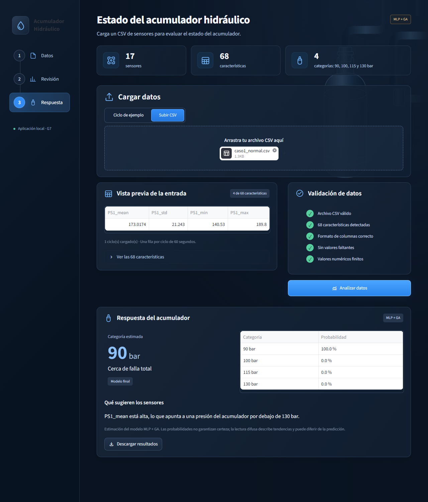
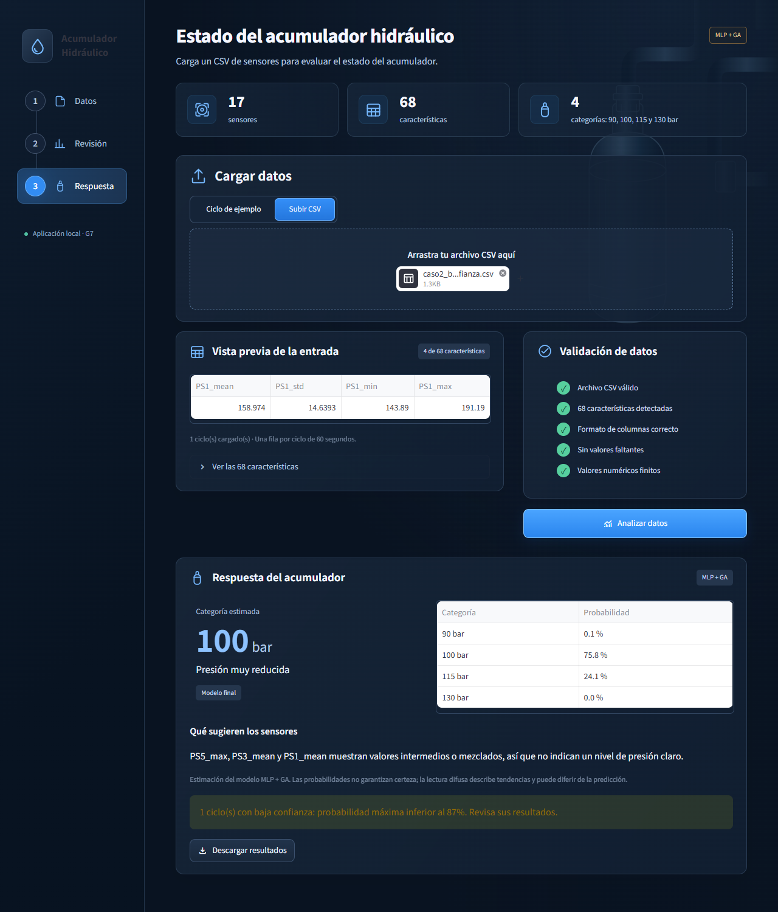
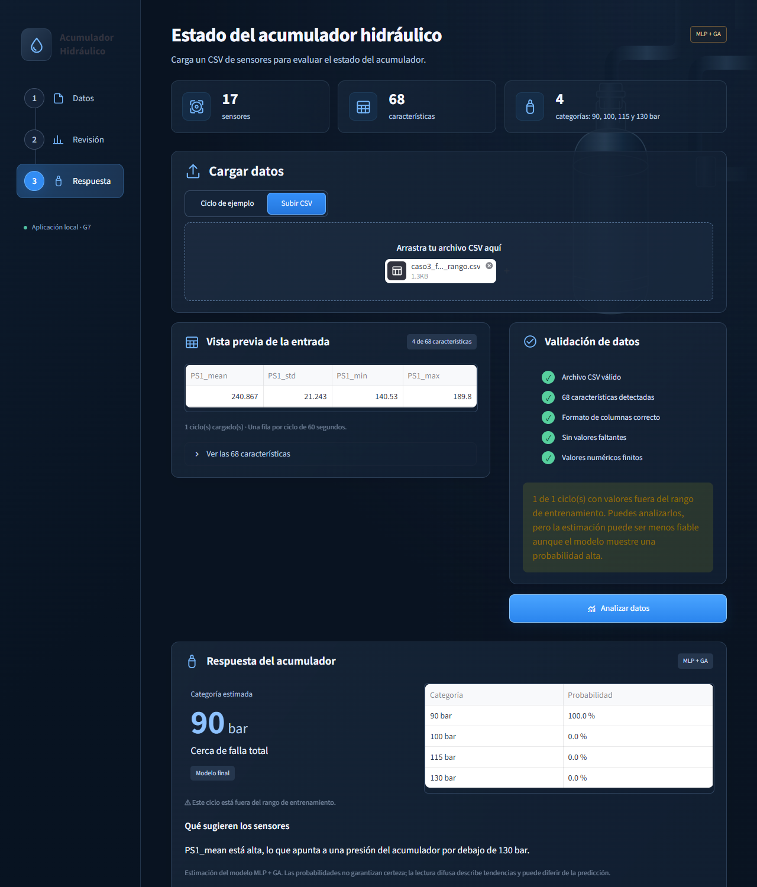
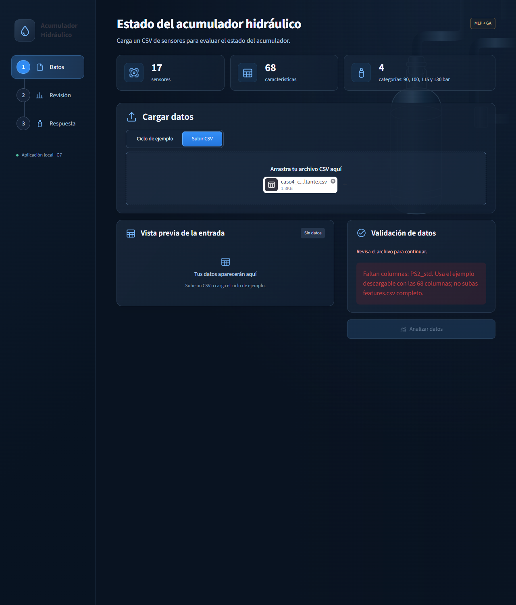

# Inteligencia Computacional · Grupo G7

## Tema

**Tema 7: industria.** Clasificación del nivel de presión de un acumulador
hidráulico a partir de las mediciones de 17 sensores.

## Problema del proyecto

La pérdida de presión del acumulador puede afectar el funcionamiento de un
sistema hidráulico. A partir de las lecturas de los sensores durante un ciclo
de 60 segundos, se busca estimar a qué categoría corresponde el acumulador:
**90, 100, 115 o 130 bar**, como apoyo para el personal de mantenimiento.

El análisis se limita al acumulador; no determina el estado de los demás
componentes ni el momento en que se detendrá la máquina.

**Bar** es una unidad de presión. En este proyecto, las categorías del acumulador
se interpretan así:

| Presión del acumulador | Estado que representa |
|---|---|
| **90 bar** | Cercano a falla total; es la categoría de mayor deterioro. |
| **100 bar** | Presión muy reducida. |
| **115 bar** | Presión algo reducida. |
| **130 bar** | Presión óptima; es la condición de referencia en buen estado. |

## Datos y licencia

Se utiliza el conjunto [Condition monitoring of hydraulic systems](https://archive.ics.uci.edu/dataset/447/condition+monitoring+of+hydraulic+systems),
de Nikolai Helwig, Eliseo Pignanelli y Andreas Schütze (2015), publicado en
UCI Machine Learning Repository.

- **DOI:** [10.24432/C5CW21](https://doi.org/10.24432/C5CW21).
- **Licencia de los datos:** [Creative Commons Attribution 4.0 International (CC BY 4.0)](https://creativecommons.org/licenses/by/4.0/).
- **Fecha de consulta:** 23 de octubre de 2026.

Los datos originales contienen 2205 ciclos de 60 segundos y mediciones de
17 sensores. Para este proyecto, las series se transforman en las 68 estadísticas
descritas en el formato del CSV. Se reconoce la autoría del conjunto original;
esta referencia de licencia corresponde a los datos.

### Diccionario de variables

Cada sensor se resume en cuatro estadísticos por ciclo (`mean`, `std`, `min`,
`max`); la columna se llama `{sensor}_{estadístico}`, por ejemplo `PS1_mean`.

| Sensor | Magnitud | Unidad | Frecuencia original |
|---|---|---|---|
| PS1–PS6 | Presión | bar | 100 Hz |
| EPS1 | Potencia del motor | W | 100 Hz |
| FS1, FS2 | Caudal | l/min | 10 Hz |
| TS1–TS4 | Temperatura | °C | 1 Hz |
| VS1 | Vibración | mm/s | 1 Hz |
| CE | Eficiencia de refrigeración (sensor virtual) | % | 1 Hz |
| CP | Potencia de refrigeración (sensor virtual) | kW | 1 Hz |
| SE | Factor de eficiencia | % | 1 Hz |

Variable objetivo: presión del acumulador (`accumulator`), codificada como
90 bar → 0, 100 bar → 1, 115 bar → 2 y 130 bar → 3. El estado de los demás
componentes (`cooler`, `valve`, `pump_leak`) y la anotación `stable` no son
entradas del modelo.

### Limitaciones

- **Un único banco de pruebas de laboratorio**, con 144 combinaciones de estados
  de componentes. No se sabe cómo generaliza a otras instalaciones.
- Los niveles de presión se **fijaron a propósito** en el banco; no son una
  degradación natural y gradual.
- **Clases desiguales:** 808, 399, 399 y 599 ciclos (90, 100, 115 y 130 bar).
  Por eso la métrica principal es el F1 macro.
- **Grupos desiguales:** tres combinaciones suman el 36,8 % del entrenamiento
  (672 ciclos), de modo que la validación cruzada varía mucho entre pliegues.
- **Una sola evaluación en prueba** (378 ciclos de 33 grupos), sin intervalo de
  confianza.
- Las probabilidades **no están calibradas**, y el umbral de baja confianza
  (0,87) se calibró con datos de entrenamiento, por lo que es algo optimista.
- La app **no verifica la fiabilidad fuera del rango de entrenamiento**: procesa
  el ciclo con una advertencia y el modelo puede responder con probabilidad alta.
- Es una **ayuda a la decisión** para revisión humana, no un diagnóstico.

## Integrantes

- José Eduardo Ponce Carlos.
- Luis Alfredo Anchundia Cruz.
- Dayron Adrian Quiñónez Valencia.

## Estructura del proyecto

```text
app/
  app.py                       Flujo de la aplicación Streamlit
  assets/                      Estilos CSS y fondo SVG local
src/ic_g7/
  config.py                    Rutas, clases, semilla y columnas compartidas
  datos.py                     Carga de entrenamiento y prueba
  evaluacion.py                Validación cruzada y métricas
  pipeline.py                  Preparación común dentro de cada pliegue
  experimentos_dayron.py        Random Forest con búsqueda y MLP base
  modelo_final.py               Reentrenamiento y evaluación única reservada
  prototipo.py                 Validación del CSV de sensores
  inferencia.py                Carga del modelo final y predicción por ciclo
  interfaz/                    Componentes visuales y carga del tema
scripts/                       Descarga y preparación de los datos
data/
  raw/hydraulic/               Mediciones originales (no se suben a Git)
  processed/
    features.csv               Datos preparados (generado; no se sube a Git)
    split.csv                  Partición compartida de entrenamiento y prueba
notebooks/                     01 EDA · 02 KNN y SVM · 03 algoritmo genético · 04 Random Forest y MLP, umbral de confianza · 05 explicación difusa
models/                        Modelo final entrenado, etiquetas y metadatos
reports/                       Resultados, figuras y evaluación final
  prototipo/                   CSV de entrada y capturas de las pruebas de la app
tests/                         Comprobaciones de datos, modelos y prototipo
requirements.txt               Dependencias del proyecto
pyproject.toml                 Configuración del paquete local
README.md                      Descripción e instrucciones de uso
```

## Formato del CSV

La aplicación recibe **una fila por ciclo de 60 segundos** y **68 columnas**:
17 sensores × 4 estadísticos (promedio, desviación estándar poblacional, mínimo
y máximo). Las mediciones crudas se resumen antes de cargar el archivo.

- Los nombres deben coincidir con las columnas de
  [config.py](src/ic_g7/config.py), por ejemplo `PS1_mean`, `PS1_std`, `PS1_min`
  y `PS1_max`. La app ordena las columnas automáticamente.
- Codificación UTF-8, con o sin BOM; separador de comas y punto decimal.
- Se admite uno o varios ciclos, hasta **5 MB**. Cada fila produce un resultado.
- No incluir `accumulator`, `clase`, `cycle_id`, `group_id` ni `stable`.
  No subir `features.csv` completo, porque contiene etiquetas e identificadores.

En **Ciclo de ejemplo → Descargar ejemplo** se obtiene una plantilla con las
68 columnas y un ciclo de entrenamiento.

## Validaciones

El archivo se rechaza completo, sin predicción, si:

- Está vacío, no contiene ciclos o supera el límite de tamaño.
- Faltan columnas, sobran columnas o hay nombres duplicados.
- Alguna fila tiene una cantidad incorrecta de campos.
- Hay valores nulos, no numéricos o infinitos.

La app muestra el motivo del rechazo y, cuando corresponde, el registro y la
columna afectados.

Los valores numéricos finitos fuera del rango de entrenamiento **no bloquean el
análisis**: se muestra una advertencia y se marca cada ciclo afectado como
`Fuera de rango`, también en la descarga. No se recortan ni modifican los valores.
Estos rangos proceden exclusivamente del entrenamiento y no son límites físicos
del equipo. Se conserva una tolerancia mínima por redondeo numérico.

## Experimentos de Random Forest y MLP

El aporte de Dayron está en
[04_modelos_dayron.ipynb](notebooks/04_modelos_dayron.ipynb). Contiene el
procedimiento explicado, las salidas ejecutadas y las limitaciones de la comparación.
La lógica se reutiliza desde `src/ic_g7/experimentos_dayron.py`.

Con el entorno y los datos preparados, ejecutar **el notebook completo o el script**:

```powershell
& ".\.venv\Scripts\python.exe" scripts/entrenar_modelos_dayron.py
```

Se evalúan Random Forest por defecto, Random Forest ajustado y MLP por defecto,
usando solo los **1827 ciclos de entrenamiento**, la partición compartida y los
cinco pliegues por grupos. Todos usan `crear_pipeline` y `validar_cruzado`.
La MLP conserva los valores predeterminados salvo `max_iter=4000` y la semilla
de `config.py`, como acordó José.

La búsqueda de RF prueba 27 combinaciones: `n_estimators` en 100, 200 y 300;
`max_depth` en `None`, 10 y 20; `min_samples_leaf` en 1, 2 y 4.
Se selecciona por F1 macro. La ejecución es en serie, con un hilo BLAS;
el hardware, las versiones, el coste de búsqueda y los hashes de datos y
partición quedan en `reports/entorno_dayron.json`.

El experimento genera únicamente sus archivos en `reports/`:

| Archivo | Contenido |
|---|---|
| `resultados_dayron.csv` | Tres filas con las columnas de la tabla común. |
| `pliegues_dayron.csv` | F1 macro, exactitud y ROC-AUC de cada pliegue. |
| `metricas_clase_dayron.csv` | Precisión, recall, F1 y soporte de cada categoría. |
| `matrices_confusion_dayron.csv` | Recuentos reales frente a predichos, en bar. |
| `predicciones_oof_dayron.csv` | Predicción y probabilidades de cada ciclo excluido del ajuste de su pliegue. |
| `busqueda_rf_dayron.csv` | Las 27 configuraciones evaluadas y sus puntuaciones y tiempos. |
| `figuras/matrices_confusion_dayron.png` | Las tres matrices de confusión. |

Las OOF agrupan los ciclos de validación; sus métricas por clase no son el promedio
entre pliegues. `indice_entrenamiento` identifica la posición dentro de
`cargar_entrenamiento()`, no el ciclo original. Las probabilidades todavía no
están calibradas. La MLP base de Dayron reproduce la configuración de José con
semilla 42: **no debe contarse como otro método ni como una repetición independiente**.

La selección de hiperparámetros y la comparación reutilizan los pliegues; las
cifras del RF ajustado pueden tener sesgo de selección. Son resultados de
validación, no de prueba ni una selección definitiva. Los tiempos por modelo
no incluyen la búsqueda ni la segunda pasada OOF; el coste de búsqueda se informa
por separado. Las diferencias pequeñas no prueban superioridad ni equivalencia.

Esta ejecución no consulta prueba, no exporta el modelo final y no modifica
Streamlit ni la tabla consolidada. La preparación del modelo, su evaluación final
y la aplicación se describen en las secciones siguientes.

## Tabla de resultados

Cada persona escribe sus modelos en `reports/resultados_<nombre>.csv` y no edita
`reports/resultados.csv`, que es la tabla única y se genera uniendo esos archivos.

Regenerarla desde la raíz del repositorio, cuando ya estén todos los
`resultados_<nombre>.csv` en la rama y antes de usar la tabla (comparación en el
informe o en la evaluación final):

```powershell
& ".\.venv\Scripts\python.exe" scripts/consolidar_resultados.py
```

El script falla indicando archivo y fila si falta una columna, un nombre de modelo
está vacío o repetido, una métrica no tiene el formato `media ± std` o un tiempo no
es un número finito no negativo.

## Modelo elegido y evaluación final

Se utiliza **MLP+GA (semilla 42)**, con la configuración registrada en
`reports/resultados_jose.csv`. El modelo entregado ya está entrenado con los
**1827 ciclos de entrenamiento**; su preparación está implementada en
[scripts/entrenar_modelo_final.py](scripts/entrenar_modelo_final.py).
No hace falta reentrenarlo para usar la app ni consultar los resultados.
Los artefactos guardados en `models/` son:

- `pipeline_final.joblib`: pipeline completo entrenado.
- `labels.json`: clases, presiones y estados.
- `metadata_final.json`: configuración, columnas y datos de reproducibilidad.

El script no utiliza prueba y rechaza sobrescribir artefactos existentes.

**Evaluación final completada** con los 378 ciclos de prueba de 33 grupos,
sin reentrenar ni ajustar el modelo. Resultados: **F1 macro 0,8078**, **exactitud
81,48 % (308 de 378 ciclos)** y **ROC-AUC macro OVR 0,9563**. Se cumple el criterio
(b): F1 macro ≥ 0,7037 (media de CV menos dos desviaciones).

Los archivos quedan en [reports/evaluacion_final/](reports/evaluacion_final/):

- `informe.json`: métricas globales, matriz de confusión y criterio (b).
- `metricas_clase.csv`: precisión, recall, F1 y soporte por categoría.
- `predicciones.csv`: respuesta real, predicción y probabilidades por ciclo.
- `registro.json`: constancia de la ejecución completada y hashes de modelo y partición.
- `matriz_confusion.png`: figura generada desde el informe guardado.

**No volver a ejecutar la evaluación ni borrar el registro.** El evaluador bloquea
nuevos intentos; las consultas y figuras posteriores usan los archivos guardados.
Para regenerar únicamente la figura, sin cargar el modelo ni prueba:

```powershell
& ".\.venv\Scripts\python.exe" scripts/graficar_evaluacion_final.py
```

Ejecutar las pruebas locales:

```powershell
& ".\.venv\Scripts\python.exe" -m unittest discover -s tests -v
```

## Cómo levantar Streamlit

Se requiere **Python 3.12**. Ejecutar los comandos desde la raíz del repositorio
en PowerShell. Si el entorno y los datos ya están preparados, pasar directamente
al comando de Streamlit.

Preparación inicial:

```powershell
py -3.12 -m venv .venv
& ".\.venv\Scripts\python.exe" -m pip install -r requirements.txt
& ".\.venv\Scripts\python.exe" scripts/descargar_datos.py
& ".\.venv\Scripts\python.exe" scripts/construir_features.py
```

Iniciar la aplicación:

```powershell
& ".\.venv\Scripts\python.exe" -m streamlit run app/app.py --server.address 127.0.0.1
```

Abrir http://127.0.0.1:8501. Mantener abierta la terminal; `Ctrl+C` detiene el
servidor. Cargar un CSV o el ciclo de ejemplo y pulsar **Analizar datos**.

La aplicación carga el modelo **MLP+GA (semilla 42)** desde
`models/pipeline_final.joblib`, junto con `labels.json` y `metadata_final.json`.
Comprueba su integridad y versiones al cargarlo; no lo reentrena al abrir la app.
Cada fila del CSV devuelve una categoría, sus probabilidades y la marca de baja
confianza según `config.UMBRAL_CONFIANZA` (0,87). También incluye una lectura
difusa de `PS5_max`, `PS3_mean` y `PS1_mean`, con percentiles calculados solo desde
entrenamiento al cargar los recursos. La lectura describe tendencias; no explica
el funcionamiento interno de la MLP ni cambia su predicción. Si discrepa con la
clase estimada, lo indica. Con varios ciclos se puede leer la explicación de cada
uno y descargarla junto a las probabilidades y las marcas de advertencia.
Si faltan los artefactos o no superan las comprobaciones, muestra el error y
detiene el análisis.

## Pruebas de la aplicación (casos de uso)

Cuatro entradas, todas basadas en ciclos de **entrenamiento** (nunca de prueba),
en [reports/prototipo/entradas/](reports/prototipo/entradas/), con la captura de
cada resultado en [reports/prototipo/capturas/](reports/prototipo/capturas/).
Comprobadas el 24/oct/2026 con la app local.

Para repetirlas: abrir la app (sección anterior), elegir **Subir CSV**, cargar
el archivo y pulsar **Analizar datos**.

| Caso | Archivo de entrada | Qué es | Resultado esperado |
|---|---|---|---|
| 1. Ciclo normal | `caso1_normal.csv` | Ciclo de entrenamiento `cycle_id` 612 (90 bar reales) | 90 bar con 100,0 %, sin aviso de baja confianza |
| 2. Baja confianza | `caso2_baja_confianza.csv` | Ciclo de entrenamiento `cycle_id` 1321 (100 bar reales) | 100 bar con 75,8 %, por debajo del umbral 0,87: aviso de baja confianza |
| 3. Caso límite | `caso3_fuera_de_rango.csv` | Caso 1 con `PS1_mean` = 240,867 (el máximo de entrenamiento es 180,867) | Se procesa con advertencia y marca `Fuera de rango`; responde 90 bar con 100,0 %: una probabilidad alta no garantiza fiabilidad fuera del rango |
| 4. Entrada inválida | `caso4_columna_faltante.csv` | Caso 1 sin la columna `PS2_std` | Se rechaza el archivo completo (`Faltan columnas: PS2_std`) y no hay predicción |






La explicación difusa del caso 2 indica valores intermedios o mezclados; es una
lectura de tendencias, no cambia la predicción.
